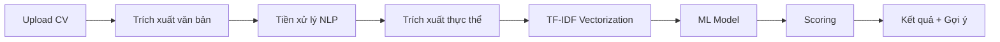

# 🎓 CV Analyzer - Hệ thống Phân tích CV bằng Machine Learning

Đồ án tốt nghiệp: **Phân tích CV và đánh giá mức độ phù hợp với vị trí thực tập CNTT bằng học máy**


## 📋 Giới thiệu

Ứng dụng web hiện đại được xây dựng bằng **Python & Streamlit** để:
- 📄 Tự động trích xuất thông tin từ CV (PDF/DOCX)
- 🤖 Chấm điểm mức độ phù hợp với vị trí thực tập bằng Machine Learning
- 📊 So sánh và xếp hạng nhiều ứng viên cùng lúc
- 💡 Đưa ra gợi ý cải thiện CV cụ thể
- 📈 Thống kê và dashboard trực quan

## ✨ Tính năng chính

### 🏠 Phân tích CV đơn lẻ
- ✅ Upload CV (PDF, DOCX), hỗ trợ OCR cho CV scan
- ✅ Trích xuất: Tên, Email, SĐT, GPA, Kỹ năng, Kinh nghiệm, Dự án
- ✅ Chấm điểm 0-100 với 4 mức độ phù hợp
- ✅ Gauge chart, Radar chart trực quan
- ✅ Danh sách kỹ năng KHỚP và CÒN THIẾU
- ✅ Gợi ý cải thiện và lộ trình học
- ✅ Xuất báo cáo Excel/Text

### 📊 So sánh nhiều CV (Batch)
- ✅ Upload nhiều CV cùng lúc
- ✅ Xếp hạng ứng viên theo điểm
- ✅ Biểu đồ phân bố điểm
- ✅ Lọc theo ngưỡng điểm
- ✅ Xuất báo cáo Excel tổng hợp

### 📈 Dashboard thống kê
- ✅ Tổng số CV đã phân tích
- ✅ Điểm trung bình, phân bố
- ✅ Top ứng viên xuất sắc
- ✅ Xu hướng theo thời gian

### 🤖 Machine Learning
- ✅ Gradient Boosting Model (R² = 0.94)
- ✅ TF-IDF Vectorization (1000 features)
- ✅ Ensemble: ML (70%) + Rule-based (30%)
- ✅ Hỗ trợ 10 vị trí thực tập IT

## 🚀 Cài đặt và Chạy

### Yêu cầu
- Python 3.8+
- pip

### Bước 1: Clone project

```bash
git clone <repository-url>
cd DACN-CV-Matching-ML
```

### Bước 2: Cài đặt dependencies

```bash
cd cv_analyzer
pip install -r requirements.txt
```

**Lưu ý OCR (tùy chọn):** Nếu muốn xử lý CV scan, cài đặt Tesseract:
- Windows: https://github.com/UB-Mannheim/tesseract/wiki
- macOS: `brew install tesseract tesseract-lang`
- Linux: `sudo apt-get install tesseract-ocr tesseract-ocr-vie`

### Bước 3: Huấn luyện model (tùy chọn)

```bash
python train_model.py
```

Nếu bỏ qua, app vẫn chạy với phương pháp rule-based.

### Bước 4: Chạy ứng dụng

```bash
streamlit run app.py
```

Mở trình duyệt: **http://localhost:8501**

## 📸 Screenshots

### 🏠 Trang Phân tích CV


### 📊 So sánh nhiều CV


### 📈 Dashboard


## 🤖 Machine Learning Pipeline



**Chi tiết:**
1. **Trích xuất**: pdfplumber, PyMuPDF, python-docx, pytesseract
2. **NLP**: Chuẩn hóa, tokenization (tiếng Việt + Anh)
3. **Entity Extraction**: Regex + 150+ kỹ năng IT
4. **Vectorization**: TF-IDF (1000 features, bigrams)
5. **Scoring**:
   - 40%: Khớp kỹ năng
   - 25%: Similarity với JD
   - 20%: Kinh nghiệm/Dự án
   - 15%: Học vấn/GPA
6. **Model**: Gradient Boosting
7. **Ensemble**: ML (70%) + Rule-based (30%)

## 📊 Hiệu suất Model

| Model | R² Score | MAE | Training Time |
|-------|----------|-----|---------------|
| Ridge Regression | 0.94 | 5.85 | 0.5s |
| Random Forest | 0.94 | 5.52 | 15.3s |
| **Gradient Boosting** | **0.94** | **5.56** | 12.8s |

## 🎨 Tech Stack

**Backend & ML:**
- Python 3.8+
- scikit-learn, XGBoost
- Pandas, NumPy

**NLP & Documents:**
- pdfplumber, PyMuPDF
- python-docx
- pytesseract (OCR)
- underthesea (Vietnamese)

**Frontend:**
- Streamlit
- Plotly
- Custom CSS (Gradient design)

## 📁 Cấu trúc Project

```
DACN-CV-Matching-ML/
└── cv_analyzer/
    ├── app.py                   # Main app
    ├── pages/                   # UI pages
    │   ├── batch_comparison.py
    │   ├── dashboard.py
    │   ├── model_info.py
    │   └── about.py
    ├── core/                    # Core logic
    │   ├── extractor.py        # PDF/DOCX extraction
    │   ├── preprocess.py       # NLP preprocessing
    │   ├── skills_db.py        # 150+ IT skills
    │   ├── scorer.py           # ML scoring
    │   └── report.py           # Export reports
    ├── models/                  # Trained models
    ├── data/                    # Datasets
    ├── assets/
    │   └── style.css           # Custom CSS
    ├── train_model.py          # Training script
    ├── requirements.txt
    └── README.md
```

## 🔧 Sử dụng Dataset Thật

Để thay synthetic data bằng CV thật:

1. Chuẩn bị CSV với columns: `cv_text`, `job_title`, `score`
2. Đặt tại `data/real_cv_dataset.csv`
3. Sửa `train_model.py`:

```python
# Thay:
df = trainer.generate_dataset(samples_per_job=100)

# Bằng:
df = pd.read_csv('data/real_cv_dataset.csv')
```

4. Chạy: `python train_model.py`

## 🎯 Use Cases

### Cho Nhà tuyển dụng / HR:
- ✅ Sàng lọc CV nhanh chóng
- ✅ Xếp hạng ứng viên theo điểm
- ✅ So sánh nhiều ứng viên
- ✅ Xuất báo cáo cho meeting

### Cho Sinh viên / Ứng viên:
- ✅ Đánh giá CV của mình
- ✅ Nhận gợi ý cải thiện cụ thể
- ✅ Biết kỹ năng còn thiếu
- ✅ Lộ trình học tập rõ ràng

## 🚀 Hướng phát triển

- [ ] Tích hợp PhoBERT cho NLP tiếng Việt tốt hơn
- [ ] Named Entity Recognition (NER) nâng cao
- [ ] Chatbot tư vấn CV
- [ ] API RESTful
- [ ] Deploy cloud (AWS, Heroku, Streamlit Cloud)
- [ ] Mobile app
- [ ] Authentication & Database

## 📝 Gợi ý Bảo vệ Đồ án

### 5 Điểm Nên Nhấn Mạnh:

1. **Tính ứng dụng thực tế cao**
   - Giải quyết bài toán HR: sàng lọc CV tốn thời gian
   - Hỗ trợ cả 2 phía: nhà tuyển dụng và ứng viên

2. **Kỹ thuật ML/AI nâng cao**
   - Pipeline đầy đủ: Extraction → NLP → Feature Engineering → ML
   - Ensemble method, multiple models comparison
   - Hỗ trợ tiếng Việt và tiếng Anh

3. **Giao diện UX/UI chuyên nghiệp**
   - Full web app hiện đại, không phải console
   - Interactive charts, real-time analysis
   - Đẹp như sản phẩm SaaS thật

4. **Tính năng đa dạng**
   - Single + Batch mode, Dashboard, Export
   - OCR support cho CV scan
   - 10 vị trí IT phổ biến

5. **Khả năng mở rộng**
   - Code module hóa, dễ maintain
   - Có thể thay dataset thật, fine-tune
   - Deploy được lên cloud

## 👨‍💻 Tác giả

**Sinh viên:** [Tên của bạn]  
**MSSV:** [Mã số]  
**Lớp:** [Tên lớp]  
**Khoa:** Công nghệ Thông tin  
**GVHD:** [Tên giảng viên]  

## 📞 Liên hệ

- 📧 Email: [email@example.com]
- 🔗 GitHub: [github.com/username]
- 💼 LinkedIn: [linkedin.com/in/profile]

## 📄 License

MIT License - Xem file [LICENSE](LICENSE) để biết thêm chi tiết

---

<div align="center">

**🎓 Đồ án Tốt nghiệp - Khoa Công nghệ Thông tin**

💡 Được xây dựng với ❤️ bằng Python & Streamlit

⭐ Nếu project hữu ích, hãy cho 1 star nhé!

</div>
